<div align="center">


<br/>


<br/>

<a href="https://github.com/SilentDevC"></a>
<a href="https://www.linkedin.com/in/suren-amyan-04abb4321/"></a>




</div>

## 👋 About Me

I'm a **Computer Engineering student at the National Polytechnic University of Armenia (NPUA)** 🇦🇲, focused on computer architecture, digital logic design, and the boundary where hardware meets software.

I design **FSM-based hardware in Verilog HDL**, verify it in **ModelSim**, and build **C++ applications** with the STL and Boost. I learn fast, improve through debugging and feedback, and I'm looking for an **internship or junior role in hardware design, embedded, or systems software**.

```text
🎓 B.Eng. Computer Engineering  @ NPUA (2023 – present)
📝 Thesis (in progress)         → Arbiter design for a processor pipeline
🔭 Currently building           → CHIP-8 emulator (C++17 / SDL2) · Secure Access System (Verilog)
🌱 Always learning              → Computer architecture · Systems programming · Linux
```

<div align="center"></div>

## 🚀 Projects

| Project | What it does | Stack |
| :-- | :-- | :-- |
| 💬 [**Messaging App**](https://github.com/SilentDevC/Messaging-App) *(in progress)* | Telegram-style client/server messenger. Asynchronous HTTP server on Boost.Asio and Beast with JSON handling, a MySQL layer built around a dedicated worker thread with a job queue and `std::future` results, and a Dear ImGui client. | `C++` `Boost` `Dear ImGui` `MySQL` `CMake` `vcpkg` |
| 📁 [**File Explorer**](https://github.com/SilentDevC/FileExplorer) | Command-line file manager for navigating and managing the file system. Extensible command dispatcher, custom exceptions, binary error logging with `std::bitset`, and a restricted-paths list protecting system directories. | `C++` `std::filesystem` `fstream` `Boost.PropertyTree` |
| ⚙️ [**GCD Calculator**](https://github.com/SilentDevC/GCD-Greatest-Common-Divisor-Device) | Hardware GCD device (subtractive Euclid) with a Moore FSM control unit and an 8-bit datapath. Includes a request/done handshake, and timing races fixed through ModelSim waveform analysis. | `Verilog HDL` `ModelSim` |
| 🔐 [**Secure Access System**](https://github.com/SilentDevC/Security-System) *(debugging phase)* | Multi-module design: BCD encoder, PIPO/PISO shift registers, one-shot timers, magnitude comparator, code-selection unit. Porting a VHDL reference design to Verilog. | `Verilog HDL` `ModelSim` |
| 🎮 [**CHIP-8 Emulator**](https://github.com/SilentDevC/CHIP-8-Emulator) *(in progress)* | CPU emulator with opcode decoding, memory/register arrays and call stack handling, built to understand how a CPU executes instructions. | `C++17` `CMake` `SDL2` |

<div align="center"></div>

## 🛠️ Tech Stack

<table>
  <tr>
    <td width="50%" valign="top">
      <h3>🔌 Hardware &amp; Digital Design</h3>
      
      
      
      
      
      
    </td>
    <td width="50%" valign="top">
      <h3>💻 Programming</h3>
      
      <p><b>C++ (OOP · STL · template metaprogramming basics) · C · Python (basics) · SQL · Bash · Data Structures &amp; Algorithms</b></p>
    </td>
  </tr>
  <tr>
    <td colspan="2" valign="top">
      <h3>🧰 Systems, Networking &amp; Tools</h3>
      
      <p>  </p>
      <p><b>Operating Systems · Computer Networks · Multithreading &amp; async programming (basics)</b></p>
    </td>
  </tr>
</table>

<div align="center"></div>

## 🌍 Languages

🇬🇧 English (C1) · 🇦🇲 Armenian (native) · 🇷🇺 Russian (native)

<div align="center"></div>

<div align="center">

### 🤝 Let's Connect

<a href="https://www.linkedin.com/in/suren-amyan-04abb4321/"></a>
<a href="https://github.com/SilentDevC"></a>


</div>
